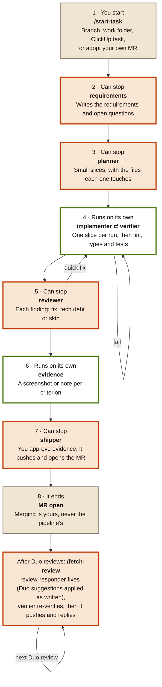
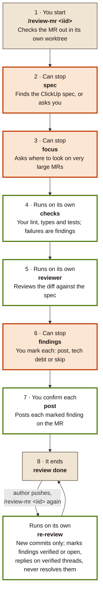

# From ClickUp task to reviewed merge request

How the Copilot delivery pipeline delivers and reviews work, as of v2.5.0. This
is the team presentation written out as a document, one section per slide. The
speaker notes are under each slide's **Notes**.

Status as of 2026-11-26.

---

## 1. What it is: Copilot agents that each do one step of delivery

You install it into your own project. It runs in your VS Code, on your Copilot
plan and your own ClickUp and GitLab accounts.

| You decide | It never merges | Nothing to host |
|---|---|---|
| It stops only where a decision is yours: requirements, a risky plan, unclear findings, before the push. | Merging the MR stays with you and your team, every time. | No server and no MCP. ClickUp goes through its REST API, GitLab through `glab`. |

Notes

Instead of one big chat session, delivery is split into stages, and each stage is
its own Copilot agent with one job. A pipeline agent, the orchestrator, runs them
in order as subagents. You stay in charge of every decision that matters, it
never merges anything, and there's nothing to host: it only runs scripts in your
terminal.

---

## 2. The delivery route: one command takes a task to an open MR

Orange boxes **can stop** and wait for you; green boxes **run on their own**.

Notes

You pick the pipeline agent and run `/start-task` with the ClickUp id, or
`/start-task <id> --mr <iid>` to adopt an MR you started by hand. Requirements reads the whole task, including comments and attachments, and lists
open questions. The planner cuts the work into small slices. The implementer
builds one slice per run and the verifier runs our own lint, type check and
tests; failures loop back. A project without Playwright skips e2e and records
it as a gap. The reviewer does an in-depth review, and for each
finding you decide: fix it, park it as tech debt, or skip it. Evidence captures
a screenshot per acceptance criterion. The shipper writes the MR description,
and once you approve the evidence it pushes and opens the MR. After Duo reviews
the MR, `/fetch-review` starts the response loop.

---

## 3. Where you decide: the auto run stops only for decisions that are yours

| Stop | When it waits for you |
|---|---|
| Requirements | Open questions to answer; with none, you approve it at the plan stop |
| Plan | A Stop flag, more than 6 slices, or requirements still to approve |
| Review | An unclear finding, or a fix sent back to requirements or planner |
| Pre-ship | Always: you tick the evidence and approve it |
| Duo | Threads that ask you something, or fixes to push |

Any stage also stops if it stalls (changed nothing) or uses up its fix rounds
(`MAX_AUTO_FIX_ROUNDS`).

Notes

Two stops always happen: approving the requirements, and approving the evidence
before anything is pushed. The others only fire when there's something genuinely
ambiguous. The two safety stops mean it can never spin.

---

## 4. The ship gate: only verified code is pushed

1. It's the task's own branch.
2. It's the exact commit the checks passed on, recorded as `verified-head`.
3. A new MR needs the evidence approved at that same commit.

All three rules live in one script, `scripts/agent/ship-gate.sh`. A commit added
after verification can't slip out.

Notes

When the full check suite passes on a clean tree, that commit is recorded as
`verified-head`. The push and MR scripts refuse to push any other commit, so a
commit added after verification can't be pushed until it's verified again. All
of it sits in one file, so it's easy to audit.

---

## 5. Guardrails: rules the agents can't talk their way past

| | |
|---|---|
| **A guard on every tool call** | A hook blocks secrets, destructive git, raw pushes and edits to the pipeline itself. |
| **Publishing needs you** | Anything that publishes outside your machine asks for your confirmation first. |
| **Tech debt stays local** | Parked findings go to `.work/<task>/tech-debt.md` and are sent nowhere unless you choose. |
| **Token-conscious** | Condensed test output, a file handoff between stages, and re-reviews of new commits only. |

Notes

The guardrails are enforced by scripts and hooks, not by asking the model nicely.
A hook runs before every agent tool call.

---

## 6. Models: each stage gets the model that suits its job

| Agent | Model | Why |
|---|---|---|
| requirements, planner | Claude Opus 5.5 | Misreading the ticket or the design is the costliest mistake |
| implementer | Claude Sonnet 5.5 | Most tokens are spent here: solid work at mid price |
| verifier, reviewer | GPT-6 Sol | Another model family grades the code more independently |
| evidence, gap-checker | Claude Sonnet 5.5 | UI work: Playwright specs, screenshots, browser checks |
| review-responder | Grok 4.7 | Triage and small fixes, cheap output |
| shipper, pipeline | GPT-6 Luna | Mechanical work: the cheapest model |

Never pick **Auto** in the model picker (it overrides the pins) or a fast or
priority mode (several times the cost).

---

## 7. Added in v2.1: review a teammate's MR with one command

Run `/review-mr 142` for MR !142. Once it's merged or closed, `/cleanup mr-142`
removes the worktree. Focus stops only when the MR has more than
`MR_REVIEW_MAX_FILES` files.

Notes

The same pipeline can now review an MR that already exists. It checks the MR out
into a separate worktree, finds the ClickUp spec (and asks you if it can't), and
on a very large MR asks where to focus. It runs our checks, where failures
become findings, then reviews the diff against the spec. You decide per finding,
and you confirm each post. After the author pushes, running it again reviews only
the new commits.

---

## 8. Safe to point at someone else's MR

| | |
|---|---|
| **Your work is untouched** | The MR runs in a separate review worktree. Your branch and uncommitted changes stay as they are. |
| **Read-only on the MR** | The review never changes the MR's code. The guard protects the review worktree. |
| **Nothing posts unasked** | A finding reaches the MR only when you mark it post and confirm it. |
| **Threads stay human** | It replies on threads the author fixed, and never resolves them. That stays with people. |

The design is in [ADR 0003](adr/0003-mr-review-a-second-route.md).

---

## 9. New in v2.2 to v2.4: fewer blockers, less rework

| | |
|---|---|
| **Adopt your own work** (v2.2) | `/start-task <id> --mr <iid>` or `--branch <branch>` runs an MR you started by hand through the whole route ([ADR 0004](adr/0004-a-task-can-adopt-an-existing-branch-or-mr.md)). |
| **Duo suggestions applied, not rewritten** (v2.2) | A script applies a Duo `suggestion` block exactly as written, and refuses if the lines changed. |
| **No Playwright, no blocker** (v2.3, v2.4) | Without Playwright, e2e is skipped, and a UI criterion whose logic is unit- or integration-tested passes with a recorded gap; evidence falls back to text ([ADR 0005](adr/0005-a-live-browser-check-never-feeds-the-ship-gate.md)). |
| **Check the gaps** (v2.4) | Pick the **gap-checker** agent at the pre-ship stop: it walks those criteria in VS Code's built-in browser and writes down what it saw. |

Notes

Changes since v2.1. You can hand the pipeline work you began yourself: it
adopts your branch or MR, credits the commits already there, and fixes the rest.
Duo's suggestion blocks are applied by a script, which saves tokens and lands
exactly what the reviewer asked for. Projects without Playwright no longer get
stuck: e2e is skipped, a UI criterion whose logic is tested below e2e passes with
a recorded gap, evidence falls back to text plus any screenshots you save, and
the pre-ship stop says how many gaps there are. Before approving, you can pick
the gap-checker agent to walk those criteria in VS Code's browser. It has to be
an agent you pick: we tested it, and VS Code doesn't give subagents the browser
tools. A browser check never counts as a test, so the ship gate still only
trusts repeatable checks. Smaller: a local install keeps all your agent skills
out of git.

---

## 10. New in v2.5: less to tidy, fewer stops

| | |
|---|---|
| **Clean up finished tasks** | Once an MR is merged or closed, `/cleanup <id>` removes its branch (merged only), its `.work/` folder and, for an MR review, its worktree. `/cleanup --finished` does them all. |
| **One stop when nothing is open** | Requirements with no open questions are approved with the plan, at the plan stop ([ADR 0006](adr/0006-the-requirements-stop-waits-for-the-plan-when-nothing-is-open.md)). |
| **Handed to the right agent** | `/start-task` and `/fetch-review` point you to the **pipeline** agent instead of into manual mode. |
| **Test tooling per stack** | Doctor shows ready-to-paste test commands, and the tools to install, for a Node or Laravel project. |

Notes

Cleanup refuses while the MR is open, with uncommitted changes, or while parked
tech debt is still undecided, so nothing is lost silently; doctor lists every
finished task with its `/cleanup` command. When the requirements have no open
questions, the run goes straight on to the planner and you approve both at the
plan stop. Doctor's test tooling only recommends; it never writes your settings.

---

## 11. How it's built: test-first, decided in the open

| 1,590 | 6 | 11 |
|---|---|---|
| automated checks across 17 test scripts, all passing on main | architecture decision records: the [auto run](adr/0001-auto-run-through-an-orchestrator-and-subagents.md), [making it the main path](adr/0002-v2-auto-run-is-the-main-path.md), [MR review](adr/0003-mr-review-a-second-route.md), [adopting a branch or MR](adr/0004-a-task-can-adopt-an-existing-branch-or-mr.md), [live checks never feed the ship gate](adr/0005-a-live-browser-check-never-feeds-the-ship-gate.md), and [one stop when nothing is open](adr/0006-the-requirements-stop-waits-for-the-plan-when-nothing-is-open.md) | releases so far, from v1.0.0 to v2.5.0, each tagged on GitHub |

Every change lands on its own branch, test first, with each new test proven to
fail before the fix.

---

## 12. Where it stands: v2.5.0 is out; more real runs are next

| Status | What |
|---|---|
| ✅ **Done** | v2.1.0 to v2.5.0 released: MR review, adopting your own work, applied suggestions, UI work without Playwright, gap checks, cleanup of finished tasks, and one fewer stop. `/review-mr` has been tried on a real GitLab MR, and it works. Pinned models are confirmed on a paid plan (#67). |
| 🔶 **In progress** | First real runs: a task in a project without Playwright, and gap-checker in VS Code. |
| ➡️ **Next** | v2.5's `/cleanup` and the combined plan stop on real tasks. |

---

## 13. What I'd like from the team: help prove it on real work

1. **An MR to review.** `/review-mr` works on real GitLab: point it at your open MRs and tell me what it missed.
2. **A small task.** Run one ticket through the delivery route, ideally in a project without Playwright, try the gap-checker agent at the pre-ship stop, run `/cleanup` once its MR is merged, and note where it stopped.
3. **Your feedback.** Which stops are worth keeping, and which can go.

Questions?
